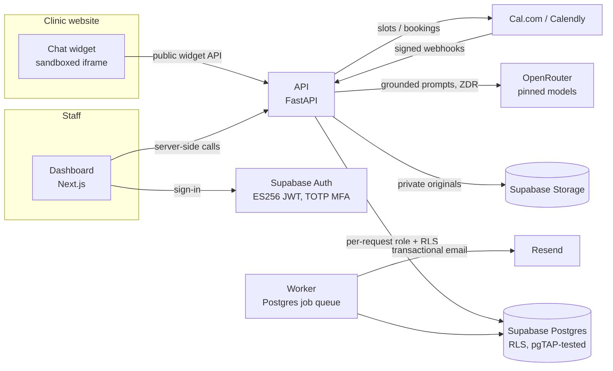

# ZUVOORA Engage

**AI-assisted patient engagement for eye clinics — by ZubeVision Technologies Ltd.**

[](https://github.com/dr-nzube-anthony-anyanwu/ZUVOORA-ENGAGE/actions/workflows/quality.yml)
[](https://github.com/dr-nzube-anthony-anyanwu/ZUVOORA-ENGAGE/actions/workflows/security.yml)

ZUVOORA Engage is a multi-tenant SaaS platform that lets an eye clinic add its own assistant to
its existing website. The assistant answers patients' administrative questions (opening hours,
prices, services, preparation for visits) **only from information the clinic has approved**,
books appointments in the clinic's own calendar, sends confirmations and reminders, and hands a
conversation to the clinic team whenever a person is needed. Clinic staff manage everything from a
web dashboard; ZubeVision manages clinics, plans and usage from a platform console.

> **Status:** Phases 0–5 are complete and accepted (including Phase 3g, AI reading of scanned
> documents) and the design track (brand, public website, demo requests, restyled dashboard and
> widget). Phase 6 — production deployment, monitoring, backups, legal review and pilot
> onboarding — has **not** started. The system has not been deployed publicly and must not be
> used with real patient data until Phase 6 is accepted.

---

## Contents
- [What it does](#what-it-does)
- [Safety principles](#safety-principles)
- [Architecture](#architecture)
- [Technology stack](#technology-stack)
- [Repository layout](#repository-layout)
- [Getting started](#getting-started)
- [Configuration](#configuration)
- [Testing and quality](#testing-and-quality)
- [Continuous integration](#continuous-integration)
- [Plans and usage](#plans-and-usage)
- [AI usage and cost control](#ai-usage-and-cost-control)
- [Security model](#security-model)
- [Project status and roadmap](#project-status-and-roadmap)
- [Documentation](#documentation)
- [Contributing](#contributing)
- [Ownership and licence](#ownership-and-licence)

---

## What it does

### For patients (website chat widget)
- A chat window on the clinic's **verified** website, isolated in a sandboxed iframe.
- Answers from the clinic's published facts, FAQs, services and approved documents; an honest
  "I don't have that information" when the answer is not there — never an invented one.
- Immediate emergency guidance (e.g. sudden vision loss, chemical splash) and a refusal to give
  diagnoses, medical advice or treatment recommendations.
- Live appointment booking through the clinic's Cal.com (or Calendly) account, confirmed only
  after the scheduling provider confirms it.
- "Contact the clinic team" call-back requests at any point in the conversation.

### For clinic staff (dashboard)
| Area | What staff can do |
|---|---|
| Clinic content | Profile, branches with structured opening hours and holidays, services and prices, FAQs — all with draft → review → publish |
| Documents | Upload PDF, Word, text, Markdown, **photos and scanned PDFs** (read by AI); every extracted text must be reviewed and approved before the assistant can use it |
| Website domains | Register domains and prove ownership with a DNS TXT record; the widget only loads on verified domains, which are re-checked daily |
| Chat widget | Enable the widget, set the greeting, copy the embed snippet, rotate the public key |
| Inbox | Call-back requests and conversations, with the reason for each answer; new → in progress → resolved |
| Scheduling | Connect Cal.com or Calendly with an API key, choose which appointment types patients may book, set up booking webhooks, 2-hour reminders |
| Appointments | See bookings made through the assistant and cancel them through the provider |
| Team | Invite staff (owner, admin, receptionist, viewer), change roles, revoke access |
| Analytics | Conversations, answer sources, call-backs, bookings; daily trends, AI cost and unanswered topics on higher plans |
| Plan & usage | Current plan, included features, monthly usage against limits |

### Public website
- Homepage telling the product story, with honest feature availability, a scripted demo
  conversation, the four plans (pricing on request) and a roadmap of features still in development.
- "Request a demo" form for clinics (business contact details only, spam-protected); an
  accessibility statement. Checked automatically against WCAG 2.2 AA.

### For ZubeVision (platform console, MFA required)
- Create and suspend clinics, assign plans and per-clinic overrides, edit the plan catalogue.
- Platform overview: per-clinic usage, AI cost and estimated monthly revenue.
- Demo requests from the public website (kept for 12 months).

### Background work (worker)
- Durable Postgres job queue: booking confirmations and clinic alerts, 24-hour and optional
  2-hour reminders, cancellation notices, call-back alerts, quota alerts, booking reconciliation.
- Every job re-checks the current state before sending (a cancelled booking never gets a reminder).
- Daily website-domain re-verification.

## Safety principles
1. **Administrative only.** The assistant never diagnoses, prescribes or interprets symptoms; safety
   rules run before any AI model and override it.
2. **Grounded or silent.** Answers come only from content the clinic has published or approved; an
   output guard rejects numbers, links or contact details that are not in the clinic's sources.
3. **A human is always one click away.**
4. **No false confirmations.** A booking is confirmed to the patient only after the provider
   confirms it; uncertain outcomes are reconciled and handed to staff.
5. **Tenant isolation everywhere.** Enforced by PostgreSQL Row-Level Security *and* the API — never
   by the browser.
6. **Minimum data to AI.** Only published clinic content and the visitor's question are sent to a
   model, through zero-data-retention providers that do not train on the data. Patients cannot
   upload files.

## Architecture



- **API** (`apps/api`): the only component with database credentials. Each request verifies the
  user's JWT, then runs inside a transaction that switches to a restricted database role
  (`engage_app` for staff, `engage_widget` for the public widget, `engage_jobs` for the worker), so
  RLS applies to every query.
- **Dashboard** (`apps/web`): Next.js Server Components and Server Actions; no secrets in the
  browser (a build step fails if one appears in browser bundles).
- **Widget** (`apps/widget`): a tiny loader and an iframe page served by the API with a
  `frame-ancestors` policy listing only the clinic's verified domains.
- **Worker**: the same Python package as the API (`python -m app.worker`), claiming jobs with
  `SKIP LOCKED` leases, retries with backoff and idempotency keys.

Design decisions are recorded as ADRs in [`docs/decisions/DECISION_LOG.md`](docs/decisions/DECISION_LOG.md).

## Technology stack

| Layer | Technology |
|---|---|
| API | Python 3.12, FastAPI, Pydantic v2, psycopg 3 (connection pool), PyJWT (ES256 via JWKS) |
| Dashboard | Next.js 16, React 19, TypeScript |
| Widget | Plain TypeScript (no framework), served by the API |
| Database | Supabase (PostgreSQL 17, Auth, Storage), Row-Level Security, pgTAP tests |
| AI | OpenRouter (server-side only), pinned primary + backup models per tier |
| Document parsing | pypdf, python-docx, Pillow, PDFium (`pypdfium2`) in an isolated, resource-limited subprocess |
| Scheduling | Cal.com API v2, Calendly API (adapter), HMAC-verified webhooks |
| Email | Resend (idempotent sends, non-production recipient allowlist) |
| Jobs | PostgreSQL queue + Python worker (no Redis) |
| Encryption | AES-256-GCM for third-party credentials (`cryptography`), key rotation supported |
| Testing | pytest, pgTAP, Playwright (Chromium), Ruff, ESLint, TypeScript |
| Security scanning | Semgrep (OWASP Top 10), gitleaks, Trivy, bundle-secret scan |
| Delivery | Docker (non-root images), Docker Compose, GitHub Actions |

## Repository layout

```text
apps/
  api/            FastAPI application, background worker and scheduled jobs (Python package `app`)
    app/routes/       HTTP endpoints (staff, platform, public widget, webhooks)
    app/services/     AI gateway, answering pipeline, extraction, scheduling, email, entitlements
    app/jobs/         Scheduled jobs (daily domain re-verification)
    tests/            Unit tests and integration tests (against local Supabase)
  web/            Next.js staff dashboard and platform console
    e2e/              Playwright end-to-end tests and local fakes (Cal.com, OpenRouter, test sites)
  widget/         Embeddable chat widget (loader + iframe)
  worker/         Placeholder; the worker lives in apps/api (python -m app.worker)
supabase/
  migrations/     Database schema, roles, RLS policies and functions (17 migrations)
  tests/          pgTAP tests (tenancy, RLS, audit, jobs, booking, plans, usage, document AI)
  templates/      Auth email templates
docs/             Product, architecture, security, operations, decisions and evaluations
prompts/          Master and phase prompts used to build the system
scripts/          Repository tooling (local environment file generation)
.github/workflows CI: quality-and-security-baseline, security-scans
docker-compose.yml API, dashboard and worker services
```

## Getting started

Everything runs locally against a Supabase stack in Docker. No cloud accounts or real secrets are
needed for development. **Use synthetic data only.**

### Prerequisites
- Python 3.12
- Node.js 24 LTS (see `.nvmrc`)
- Docker Desktop (running)
- Git

### Start and stop (every day)

After the [first-time setup](#first-time-setup) below, open **three PowerShell terminals**
(in VS Code: Terminal → New Terminal) and run one block in each, in this order:

**Terminal 1 — database** (wait until it prints the local URLs)
```powershell
cd D:\technologies\ZUVOORA-ENGAGE
npm run db:start
```

**Terminal 2 — API / backend** (wait for `Application startup complete`)
```powershell
cd D:\technologies\ZUVOORA-ENGAGE\apps\api
.\.venv\Scripts\python.exe -m uvicorn app.main:app --reload --host 127.0.0.1 --port 8073
```

**Terminal 3 — website and dashboard / frontend** (wait for `Ready`)
```powershell
cd D:\technologies\ZUVOORA-ENGAGE\apps\web
npm run dev
```

**Optional terminal 4 — background worker** (emails, reminders and alerts; locally emails are only
logged)
```powershell
cd D:\technologies\ZUVOORA-ENGAGE\apps\api
.\.venv\Scripts\python.exe -m app.worker
```

Then open:

| What | Address |
|---|---|
| Public website | http://localhost:3073 |
| Clinic and platform sign-in | http://localhost:3073/login |
| API health | http://127.0.0.1:8073/health/ready |
| Supabase Studio (local database) | http://127.0.0.1:54323 |
| Mailpit (local emails, e.g. invitations) | http://127.0.0.1:54324 |

**To stop:** press `Ctrl+C` in terminals 2, 3 and 4, then run `npm run db:stop` in terminal 1
(your local data is kept for next time).

If the drive letter of the SSD changes, replace `D:` in the paths. Troubleshooting (ports already
in use, Docker not running, PowerShell script policy):
[`docs/operations/LOCAL_DEVELOPMENT.md`](docs/operations/LOCAL_DEVELOPMENT.md#troubleshooting).

### First-time setup

Run once on a new machine (or after deleting `.venv` / `node_modules`).

1. **Database and local settings** (repository root)
   ```powershell
   cd D:\technologies\ZUVOORA-ENGAGE
   npm ci                 # installs the pinned Supabase CLI
   npm run db:start       # Postgres, Auth, Storage, Mailpit; applies migrations and the local seed
   npm run env:local      # writes apps/api/.env and apps/web/.env.local for the LOCAL stack only
   ```
   `env:local` refuses to target anything but localhost, never overwrites existing files and never
   prints keys. The first `db:start` downloads several GB of container images.
2. **API**
   ```powershell
   cd apps\api
   py -3.12 -m venv .venv
   .\.venv\Scripts\python.exe -m pip install -e ".[dev]"
   ```
3. **Website and dashboard**
   ```powershell
   cd ..\web
   npm ci
   ```
4. **Chat widget** (served by the API; rebuild after changing `apps/widget`)
   ```powershell
   cd ..\widget
   npm ci
   npm run build
   ```
5. **First sign-in.** Sign-up is disabled (invitation only). Create a user in local Studio,
   register it as a platform admin, sign in and enrol two-factor authentication at `/mfa` — see
   [`docs/operations/LOCAL_DEVELOPMENT.md`](docs/operations/LOCAL_DEVELOPMENT.md#4-create-a-local-platform-admin-to-try-the-dashboard).

### Demonstrating the product
To show the whole product to clinics (public website, patient chat on a sample clinic website,
booking, inbox, dashboard and platform console), follow the step-by-step
[**Demo guide**](docs/operations/DEMO_GUIDE.md). Two helper commands prepare a local demo:
`npm run demo:setup` (sample clinic and demo accounts) and `npm run demo:site` (sample clinic website).

### Docker Compose
`docker-compose.yml` builds the API, dashboard and worker images (all run as non-root users). It
needs a root `.env` created from `.env.example` with values for the target environment. Production
deployment (reverse proxy, HTTPS, hardening, backups) is Phase 6 work and not yet in this repository.
## Configuration

All configuration is through environment variables. [`.env.example`](.env.example) lists every
variable with safe placeholder values; real values live only in gitignored files or a deployment
secret store and must never be committed or pasted into issues, logs or chat.

| Group | Variables | Notes |
|---|---|---|
| Application | `APP_ENV`, `APP_NAME`, `LOG_LEVEL`, `API_PORT`, `WEB_PORT`, `API_CORS_ORIGINS`, `DASHBOARD_URL`, `PUBLIC_API_URL` | `APP_ENV` = development, test, staging or production; staging/production enforce https and required secrets |
| Supabase | `SUPABASE_URL`, `SUPABASE_PUBLISHABLE_KEY`, `SUPABASE_SECRET_KEY`, `DATABASE_URL` | The secret key and database URL are server-only |
| Widget | `WIDGET_TOKEN_SECRET`, `WIDGET_ALLOW_HTTP_FRAMES` | HTTP frames are refused outside development/test |
| AI answers | `AI_ENABLED`, `OPENROUTER_API_KEY`, `OPENROUTER_BASE_URL`, `AI_STANDARD_MODELS`, `AI_COMPLEX_MODELS`, `AI_TIMEOUT_SECONDS`, `AI_MAX_OUTPUT_TOKENS` | Off by default; use a dedicated key with its own credit limit |
| AI document reading | `AI_VISION_ENABLED`, `AI_VISION_MODELS`, `AI_VISION_MAX_PAGES`, `AI_VISION_MAX_OUTPUT_TOKENS`, `AI_VISION_TIMEOUT_SECONDS` | Separate switch, off by default |
| AI budgets | `AI_BUDGET_TENANT_DAILY_USD`, `AI_BUDGET_GLOBAL_DAILY_USD`, `AI_BUDGET_GLOBAL_MONTHLY_USD`, `AI_MAX_PROMPT_USD_PER_MTOK`, `AI_MAX_COMPLETION_USD_PER_MTOK` | Checked before every model call |
| Email | `EMAIL_DELIVERY`, `RESEND_API_KEY`, `EMAIL_FROM`, `EMAIL_ALLOWED_RECIPIENTS`, `WORKER_POLL_SECONDS` | `EMAIL_DELIVERY=log` (default) never sends; outside production only allowlisted recipients receive email |
| Scheduling | `CALCOM_API_URL`, `INTEGRATIONS_ENCRYPTION_KEY`, `INTEGRATIONS_ENCRYPTION_KEY_PREVIOUS` | The encryption key protects clinics' provider credentials at rest |
| Domains | `DNS_RESOLVERS`, `DNS_TIMEOUT_SECONDS`, `DOMAIN_VERIFY_COOLDOWN_SECONDS` | |

The dashboard receives only browser-safe values (`NEXT_PUBLIC_SUPABASE_URL`,
`NEXT_PUBLIC_SUPABASE_PUBLISHABLE_KEY`) plus the server-side API address.

## Testing and quality

| Suite | Command | Scope | Current result* |
|---|---|---|---|
| Database (pgTAP) | `npm run db:test` | Roles, RLS and cross-tenant denial, audit immutability, content publishing, domains, documents, widget access, retrieval, jobs, scheduling, bookings, webhooks, plans, usage metering, document AI, demo requests | 416 / 416 |
| API (pytest) | `cd apps/api; pytest` | Unit tests (JWT verification, extraction with malicious samples, AI guard and routing, providers, encryption, webhooks, vision) and integration tests through the real API and local Supabase | 527 passed, 2 skipped (Linux-only) |
| End-to-end (Playwright) | `cd apps/web; npm run build; npm run test:e2e` | Real browser → dashboard → API → database, with local fakes for Cal.com and OpenRouter and two test "clinic websites" for cross-site embedding; axe WCAG 2.2 AA checks on public pages, dashboard and widget | 20 / 20 |
| AI evaluation | `pytest tests/integration/test_evaluation.py` (hostile-model mode, part of every run and CI; the capped live mode runs only with `EVAL_LIVE=1` and a dedicated key) | 46 synthetic cases: emergency, medical-advice safety, prompt injection, tenant isolation, answer quality | 100% in the safety categories; 93.8% quality (live run) |
| Lint / types | `ruff check .`, `npm run lint`, `npm run typecheck` | | clean |
| Secret leakage | `npm run check:bundle` | Fails the build if a server secret reaches browser files | pass |

\* Local results recorded on 2026-11-22; see [`docs/operations/IMPLEMENTATION.md`](docs/operations/IMPLEMENTATION.md).

Additional practices:
- **Mutation checks**: key safeguards (tenant filters, budget checks, signature verification,
  metadata stripping, plan gates) are deliberately broken to prove a test fails, then restored.
- **No real model calls or emails in tests**: AI is forced off and replaced by a fake gateway;
  email defaults to log-only.
- Integration and E2E tests refuse to run against anything but a local Supabase and clean up the
  synthetic users, clinics and files they create.

## Continuous integration

GitHub Actions on every push to `main` (actions pinned to commit SHAs):

| Workflow | Jobs |
|---|---|
| `quality-and-security-baseline` | `database-and-api` (local Supabase, schema lint, pgTAP, Ruff, pytest incl. hostile AI evaluation, Playwright E2E), `web` (lint, typecheck, build, bundle-secret scan), `widget` (build), `secrets` (gitleaks) |
| `security-scans` | Semgrep (OWASP Top 10, pinned container), Trivy filesystem scan; also scheduled |

Database migrations are applied to the cloud project only after CI is green: dry run, apply, then
schema lint.

## Plans and usage

| | Essentials | Professional | Premium | Full ZUVOORA |
|---|---|---|---|---|
| Website chat, knowledge base, AI answers, inbox & call-backs | ✓ | ✓ | ✓ | ✓ |
| Live online booking | ✓ | ✓ | ✓ | ✓ |
| AI reading of photos / scanned documents | ✓ | ✓ | ✓ | ✓ |
| Appointment reminders | — | ✓ | ✓ | ✓ |
| Basic analytics | ✓ | ✓ | ✓ | ✓ |
| Full analytics | — | ✓ | ✓ | ✓ |
| WhatsApp *(not yet available)* | — | ✓ | ✓ | ✓ |
| Voice AI *(not yet available)* | — | — | ✓ | ✓ |
| ZUVOORA ecosystem *(not yet available)* | — | — | — | ✓ |

- Monthly limits per plan cover chat messages, AI spend, emails and bookings; totals cover
  documents, staff seats, website domains and branches. Platform admins can override any feature
  or limit per clinic.
- Usage is metered by database triggers on the events themselves, so it cannot drift.
- Over a limit: **soft for safety, hard for cost** — AI answers and new bookings pause, while
  published-information answers, emergency guidance, call-backs and emails about existing bookings
  continue. Owners are alerted once at 80% and once at 100%.
- Plans are assigned by ZubeVision; online payments are not part of the system yet.

## AI usage and cost control
- **Off by default.** Chat answers (`AI_ENABLED`) and document reading (`AI_VISION_ENABLED`) are
  separate switches.
- **Deterministic first.** Emergency rules, medical-advice refusals, structured facts and verbatim
  FAQ answers are handled without any model; the model is used only when needed.
- **Pinned models with backups** per tier (standard, complex, vision), routed by OpenRouter with
  `zdr` (zero data retention), `data_collection: deny` and a provider price cap on every request.
- **Budgets checked before every call** against the usage ledger — per clinic per day, platform
  per day and per month — plus each plan's monthly AI allowance. Worst-case cost is recorded for
  timeouts.
- **Document reading**: photos and scanned pages are re-encoded (no EXIF/GPS or other metadata),
  read one page per call, and the result must be approved by a person before use.
- Measured costs (synthetic tests, 2026-11-22): a grounded chat answer ≈ $0.00004; one scanned page
  ≈ $0.00004 with the primary vision model.

## Security model
- **Authentication:** Supabase Auth, invitation-only accounts, strong password policy, TOTP MFA
  (required for platform admins). The API verifies ES256 JWTs against the project's JWKS.
- **Authorisation:** the tenant comes from the URL path and is checked against the user's
  membership and role server-side; the database enforces the same rules with RLS (forced on every
  tenant table) under restricted, non-login roles. Browser-supplied tenant ids, roles or plans are
  never trusted.
- **Audit:** append-only audit events written in the same transaction as the action.
- **Uploads:** type detected from file bytes, active content (scripts, macros, embedded files)
  refused, parsing in an isolated subprocess with no secrets and resource limits; originals stored
  privately.
- **Widget:** loads only on verified domains (`frame-ancestors`), short-lived signed tickets and
  conversation tokens, rate limits on every public endpoint.
- **Third-party credentials:** encrypted with AES-256-GCM bound to the clinic and record; never
  returned by the API or shown again.
- **Webhooks:** HMAC verification over the raw body, freshness window, exactly-once processing.
- **Supply chain:** pinned dependencies and GitHub Actions, non-root containers, Semgrep, Trivy
  and gitleaks in CI.

Details: [`docs/security/TENANCY_AND_RLS.md`](docs/security/TENANCY_AND_RLS.md),
[`docs/security/SECURITY_BASELINE.md`](docs/security/SECURITY_BASELINE.md),
[`docs/operations/FAILURE_MODES.md`](docs/operations/FAILURE_MODES.md).

## Project status and roadmap

| Phase | Scope | Status |
|---|---|---|
| 0 | Environment and repository validation | ✅ Accepted |
| 1 | Secure foundation: auth, tenancy, RBAC, RLS, audit | ✅ Accepted |
| 2 | Clinic administration: content, domains, documents, team | ✅ Accepted |
| 3 | Widget, chat, retrieval, AI answers, evaluation, inbox, document AI (3g) | ✅ Accepted |
| 4 | Scheduling (Cal.com, Calendly), booking, webhooks, reminders, email | ✅ Accepted |
| 5 | Plans, entitlements, usage metering, quotas, analytics | ✅ Accepted |
| 6 | Hardening, deployment, monitoring, backups, legal review, pilot | ⏳ Not started |

Open items carried into Phase 6:
- Separate staging and production environments; hardened server, HTTPS reverse proxy, firewall.
- Monitoring and alerting, scheduled worker and domain re-check in deployment, backups and a
  tested restore.
- Confirm the Cal.com webhook signature format against a real delivery; live Calendly test.
- Malware scanning of uploads and stored-file retention on clinic deletion.
- Privacy notice, terms, data processing agreement, retention policy and incident runbooks
  reviewed by qualified professionals; independent security assessment; pilot acceptance.

Not built yet (shown in plans as "not yet available"): WhatsApp, voice AI, ZUVOORA ecosystem
integration, online payments.

## Documentation

| Topic | Document |
|---|---|
| Start here (Windows) | [`docs/operations/START_HERE_WINDOWS.md`](docs/operations/START_HERE_WINDOWS.md) |
| **Demo guide (step by step, end to end)** | [`docs/operations/DEMO_GUIDE.md`](docs/operations/DEMO_GUIDE.md) |
| Local development | [`docs/operations/LOCAL_DEVELOPMENT.md`](docs/operations/LOCAL_DEVELOPMENT.md) |
| Implementation tracker and evidence | [`docs/operations/IMPLEMENTATION.md`](docs/operations/IMPLEMENTATION.md) |
| Phased plan | [`docs/operations/PHASED_IMPLEMENTATION_PLAN.md`](docs/operations/PHASED_IMPLEMENTATION_PLAN.md) |
| Architecture decisions (ADR-001 – ADR-042) | [`docs/decisions/DECISION_LOG.md`](docs/decisions/DECISION_LOG.md) |
| Product requirements | [`docs/product/PRD.md`](docs/product/PRD.md), [`docs/product/PRD_FULL.md`](docs/product/PRD_FULL.md) |
| Architecture and security design | [`docs/architecture/`](docs/architecture/) |
| Tenancy, authorisation and RLS | [`docs/security/TENANCY_AND_RLS.md`](docs/security/TENANCY_AND_RLS.md) |
| Failure modes | [`docs/operations/FAILURE_MODES.md`](docs/operations/FAILURE_MODES.md) |
| Scheduled jobs | [`docs/operations/SCHEDULED_JOBS.md`](docs/operations/SCHEDULED_JOBS.md) |
| Cloud database setup | [`docs/operations/SUPABASE_CLOUD_SETUP.md`](docs/operations/SUPABASE_CLOUD_SETUP.md) |
| Provider setup checklist | [`docs/operations/PROVIDER_SETUP_CHECKLIST.md`](docs/operations/PROVIDER_SETUP_CHECKLIST.md) |
| AI evaluation report | [`docs/evaluations/PHASE3_LIVE_EVALUATION_2026-11-22.md`](docs/evaluations/PHASE3_LIVE_EVALUATION_2026-11-22.md) |
| Design system, brand and logo | [`docs/design/DESIGN_SYSTEM.md`](docs/design/DESIGN_SYSTEM.md), [`docs/brand/`](docs/brand/) |
| Homepage content and claims | [`docs/design/HOMEPAGE_CONTENT.md`](docs/design/HOMEPAGE_CONTENT.md) |
| Commercial strategy | [`docs/commercial/`](docs/commercial/) |
| Build prompts | [`prompts/MASTER_BUILDER_PROMPT.md`](prompts/MASTER_BUILDER_PROMPT.md), [`CLAUDE.md`](CLAUDE.md) |

## Contributing

Non-negotiable rules for every change:
- Keep this repository separate from the existing ZUVOORA project.
- Never trust browser-supplied tenant ids, roles, plans or permissions; enforce access in the API
  **and** in RLS.
- Never put server secrets (Supabase secret key, OpenRouter, Resend, encryption keys) in browser
  code, commits, logs or tickets. Use `.env.example` placeholders only.
- Never use real patient data in development or tests.
- The assistant is administrative, never diagnostic or prescriptive.
- A booking is confirmed only after the provider confirms it; reminders are durable, idempotent
  and re-check the booking before sending.
- Every feature ships with security and tenancy tests (pgTAP and/or API integration), and the full
  suites, lint and scans must pass before merging.
- Record significant decisions as ADRs and update the implementation tracker with the exact
  commands run and their results.
- Complete one phase and its acceptance criteria before starting the next.

## Ownership and licence

© ZubeVision Technologies Ltd. All rights reserved. No open-source licence has been granted for
this code. ZUVOORA, ZUVOORA Engage and related names are product names of ZubeVision Technologies
Ltd.
